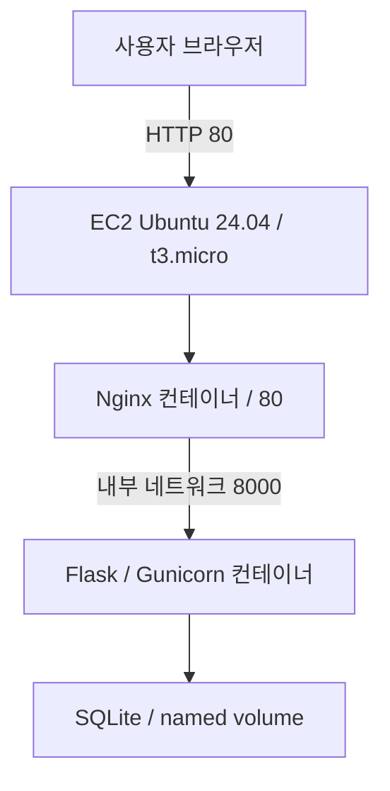

# FindBack

잃어버린 물건과 주인을 연결하는 분실물·습득물 웹서비스입니다.

- 과목: 2026학년도 2학기 클라우드컴퓨팅
- AWS 배포 주소: http://13.211.63.141/
- 공개 저장소: https://github.com/lov22eee/findback
- 검증한 애플리케이션 버전: `dbd32f72cac27253a728f1924284a0da7f667021`
- 테스트 일자: 2026-11-22 (KST)

## 서비스 소개

대상 사용자는 캠퍼스에서 물건을 잃어버리거나 발견한 학생입니다. 흩어진 분실물 정보를 한곳에서 검색하고, 습득물에 반환 요청을 남길 수 있도록 구성했습니다. 학과 행사나 축제가 끝난 직후 분실물 등록·검색 요청이 집중되는 상황을 가정했습니다. 부하 시험으로 최대 처리량을 측정한 것은 아닙니다.

## 사용자 기능

1. 분실물·습득물 등록: 유형, 이름, 장소, 날짜, 특징을 입력합니다. 습득물에는 관리 코드가 발급됩니다.
2. 물품 검색: 이름·장소·특징과 분실/습득 유형으로 검색합니다.
3. 반환 요청: 습득물 검색 결과에서 별명과 추가 특징을 입력해 반환을 요청합니다.
4. 반환 요청 관리: 게시글 번호와 관리 코드로 해당 게시글의 요청 목록을 조회합니다.

## AWS 구성과 선택 이유



- 리전: Asia Pacific (Sydney), `ap-southeast-2`
- 수업에서 사용한 기존 EC2를 재사용했습니다.
- EC2를 선택한 이유: 수업에서 사용한 Linux, Docker Compose, Nginx 실행 방식을 그대로 적용할 수 있습니다.
- Nginx만 호스트의 80번 포트로 공개합니다. Flask 8000번은 Compose 내부에서 사용합니다.
- SQLite 경로: `/app/data/findback.db`
- 데이터 볼륨: `findback_findback_data` → `/app/data`
- 보안 그룹: HTTP 80번은 공개 시연용, SSH 22번은 AWS EC2 Instance Connect 관리형 접두사 목록으로 제한했습니다. 기존 수업용 8080번의 특정 IP 제한 규칙은 보존했습니다.

## 로컬 실행

Python 및 의존성 설치 후:

```powershell
python -m venv .venv
.\.venv\Scripts\python -m pip install -r requirements.txt
.\.venv\Scripts\python app.py
```

접속 주소: `http://127.0.0.1:5000`

학교 PC의 `Dockerfile`은 사전 다운로드한 wheelhouse를 사용합니다. `wheelhouse/`는 저장소에 없으므로 인터넷 사용 환경에서 컨테이너를 실행할 때는 `Dockerfile.aws`를 사용하는 AWS용 Compose를 이용합니다.

## AWS 실행·배포

준비 사항: Ubuntu EC2, Git, Docker Engine, Docker Compose, 외부 HTTP 80번 허용.

2026-11-22 실제 서버에 Docker 29.1.3, Docker Compose 2.40.3이 이미 설치되어 있어 재설치는 생략했습니다.

```bash
git clone https://github.com/lov22eee/findback.git ~/findback
cd ~/findback
git checkout dbd32f72cac27253a728f1924284a0da7f667021
sudo docker compose -f compose.aws.yaml config --quiet
sudo docker compose -f compose.aws.yaml up -d --build
sudo docker compose -f compose.aws.yaml ps
curl -I http://127.0.0.1/
```

`web`과 `nginx` 컨테이너가 모두 Up 상태이며 서버 내부 HTTP 200 응답을 확인했습니다. `init_db()`를 실행한 뒤 Gunicorn이 시작됩니다. 별도의 로컬 DB 이전은 하지 않았습니다.

## 검증 기록

### 외부 브라우저 화면 검사

2026-11-22 GPT 내장 브라우저에서 실제 AWS 공개 주소 `http://13.211.63.141/`에 접속해 다음을 화면으로 확인했습니다.

| 기능 | 정상 입력과 실제 결과 | 실패/경계 입력과 실제 결과 |
|---|---|---|
| 등록 | 습득물 / 발표용 파란 우산 / 경동대학교 도서관 / 2026-11-22 → 등록 완료, 게시글 2 | 빈 등록 양식 제출 → 필수 정보를 모두 입력해주세요. |
| 검색 | 발표용 파란 우산 → 검색 결과 1건, 해당 물품 표시 | 존재하지 않는 고유 검색어 → 검색 결과 0건 |
| 반환 요청 | 게시글 2 / 시연사용자 / 손잡이 안쪽 별 스티커 → 요청 접수, 요청 번호 2 | 이름·물품 특징 빈 값 → 요청자 이름과 물품 특징을 모두 입력해주세요. |
| 관리 조회 | 게시글 2 / 발급받은 코드 → 요청자·특징·pending 표시 | 게시글 2 / 잘못된 코드 → 게시글 번호 또는 관리 코드가 올바르지 않습니다. |

위 각 시험의 기대 결과는 등록·요청 접수·조회 성공 또는 해당 오류 메시지이며, 실제 결과가 모두 기대 결과와 일치했습니다. 캡처에는 관리 코드 원문을 포함하지 않았습니다.

### AWS 내부 HTTP 보조 검사

외부 브라우저 검사 외에도 EC2 내부에서 Nginx의 HTTP 엔드포인트로 8건의 정상·실패 요청을 검증했습니다. 모든 응답이 기대 결과와 일치했습니다. 실제 관리 코드는 문서에 기록하지 않았습니다.

### 데이터 보존

```bash
sudo docker compose -f compose.aws.yaml up -d --force-recreate
```

두 컨테이너 재생성 후 기존 `Blue Umbrella DEMO`를 다시 검색해 유지됨을 확인했습니다. named volume을 보존하므로 컨테이너 교체 후에도 데이터가 남습니다. 기동 직후에는 Nginx가 먼저 준비되어 502가 한 번 발생했으며, 앱 기동 완료 후 재조회는 성공했습니다. 현재 구성에 애플리케이션 healthcheck 기반 기동 순서 제어는 없습니다.

## ELB·Auto Scaling 검토

이번 과제에서는 둘 다 구축하지 않았습니다. 단기 시연에 단일 EC2와 SQLite를 사용해 구성을 단순하게 유지하고, 로드 밸런서·추가 인스턴스의 유지 비용을 줄이기 위한 판단입니다. 현재 구조의 고가용성이나 대규모 동시 접속 성능을 검증한 것은 아닙니다.

확장한다면 먼저 DB를 공유 가능한 저장소로 전환하고, 상태를 공유하는 애플리케이션 구조를 준비해야 합니다. 인스턴스별 로컬 SQLite 파일만 두고 Auto Scaling을 적용하면 데이터가 분리됩니다. 이후 ALB로 요청을 분산하고 CPU·요청 수와 같은 지표에 따라 서버를 증감하도록 검토할 수 있습니다.

## AI 활용과 역할

- 사용자: 프로젝트 주제 선정, 학교 PC 기능 실행, GitHub 업로드, AWS 작업 승인. 과거 수행 사항은 사용자가 제공한 인계 내용을 기준으로 합니다.
- ChatGPT: 기존 대화에서 개념·코드·설정 관련 도움을 받았습니다.
- ChatGPT Work/Codex: 이번 작업에서 AWS 콘솔 조회, 승인 후 기존 EC2 시작, 기존 Compose 배포 명령 실행, HTTP 검증, 문서 정리를 자동 수행했습니다. 기존 애플리케이션 소스 `app.py`를 이번 배포 과정에서 변경하지 않았습니다.
- 과제 지침은 일반 AI만 허용하고 에이전틱 코딩 도구 사용을 금지합니다. 위 자동 수행을 일반 AI 사용만으로 표시하지 않으며, 적용 범위와 인정 여부는 담당 교수자에게 확인해야 합니다.
- 본인의 수동 검사를 수행하지 않은 항목을 직접 검사했다고 표시하지 않습니다.

## 비용·운영 및 자원 정리

- 단일 EC2와 공인 IPv4, 저장 공간 사용에는 비용이 발생할 수 있습니다. 계정별 크레딧·청구 정보는 공개 문서에 포함하지 않습니다.
- 검사 완료까지 실행 상태를 유지합니다. 정리 시점을 확인하기 전 임의로 중지·삭제하지 않습니다. GitHub와 README는 보존합니다.
- HTTP 시연 서비스이므로 가상 데이터만 사용합니다. 실제 이름·연락처 등 개인정보를 입력하지 않습니다. 관리 코드·AWS 자격 증명·DB는 공개 저장소에 올리지 않습니다.
- `docker compose down -v`는 데이터 볼륨을 삭제하므로 데이터 보존이 필요할 때 실행하면 안 됩니다.

